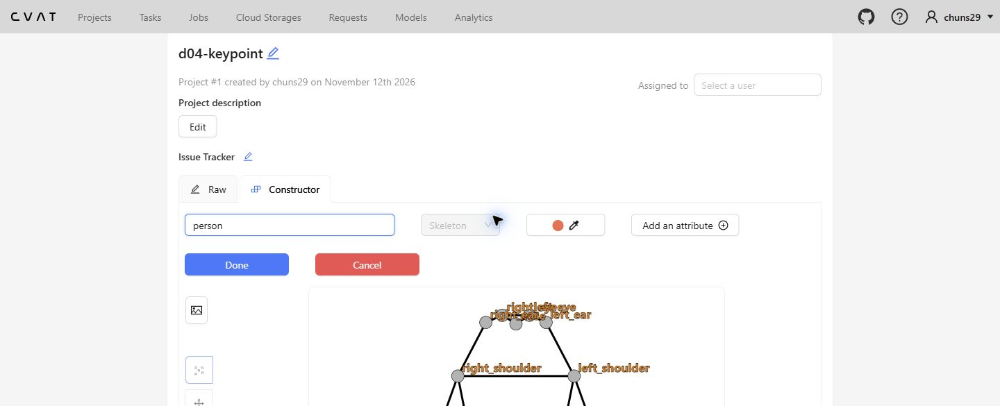
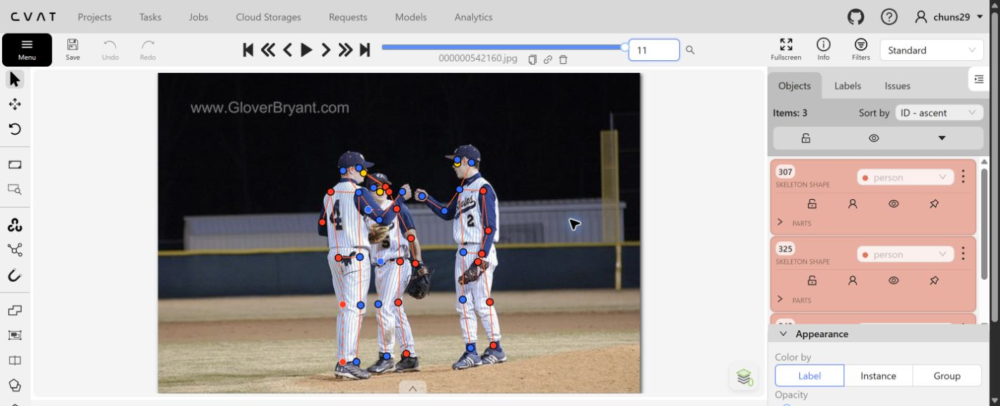
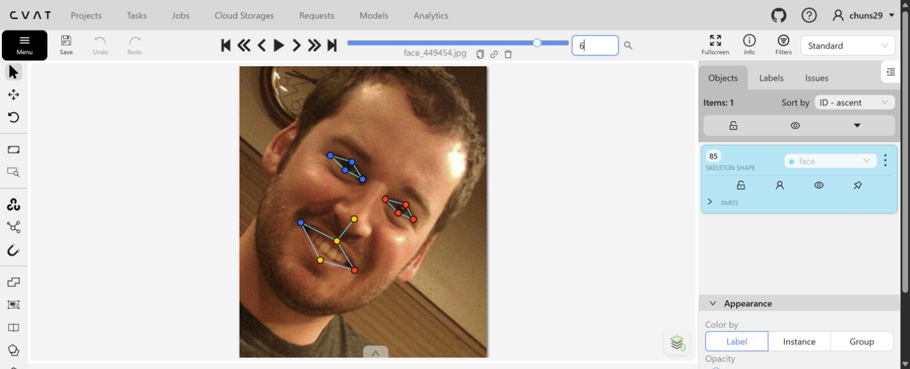
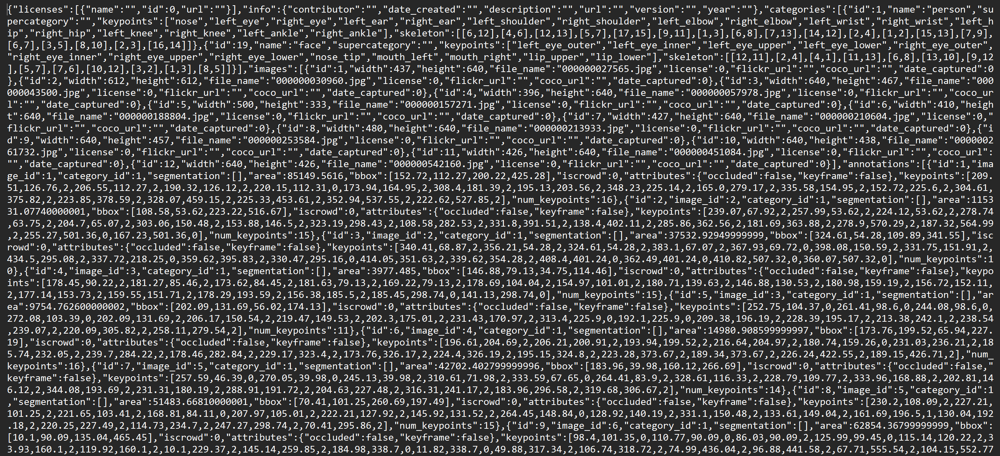

# Báo cáo cá nhân — Dương Quang Chung (2A202603217)

Bộ ảnh của lab gồm 12 ảnh người và 8 ảnh khuôn mặt. Danh sách ảnh và nguồn từng ảnh được ghi trong `src/exports/assignment.json` và `src/lab/pool.json`.

## 0. Thông tin học viên

- Họ tên: Dương Quang Chung
- MSSV: 2A202603217
- Email: 26ai.chungdq@vinuni.edu.vn
- Repository: [K5-L2-Day04-DuongQuangChung-2A202603217-KeypointPose-Student](https://github.com/chuns29/K5-L2-Day04-DuongQuangChung-2A202603217-KeypointPose-Student)
- Phiên bản CVAT: Server **2.74.1**, UI **2.74.1** (mục About).
- Máy: ASUS Vivobook X1505VA · Windows 11 26H2 (build 26300) · Intel Core i9-13900H · 15,64 GiB RAM hệ điều hành nhận diện · Docker 29.4.1 · Python 3.12.7.
- Chế độ CVAT: chạy local, chế độ đầy đủ.
- Bộ ảnh: có `src/exports/assignment.json` do `lab.py setup` tạo, gồm job người #14 và job mặt #15.
- Giờ bắt đầu: **16:00**, ngày 12/11/2026.
- Giờ kết thúc: **20:00**, ngày 12/11/2026.

## 1. Kiểm tra label (CP0)

Đối chiếu schema của lab và danh sách điểm, cạnh trong hai file xuất COCO Keypoints.

| Label | Kiểu | Số điểm | Tên điểm đúng bảng của lab? | Đúng thứ tự? | Số cạnh |
|---|---|---:|---|---|---:|
| `person` | Skeleton | 17 | Có | Có | 19 |
| `face` | Skeleton | 13 | Có | Có | 13 |

Mẫu `person` dựng theo người quay mặt về camera. Các điểm `left_*` nằm bên phải khung mẫu.

Để đổi cờ cho một điểm, rê chuột lên điểm đó rồi bấm `Q` để bật hoặc tắt `occluded`, hoặc `O` để bật hoặc tắt `outside`. Có thể mở **Objects → PARTS** để kiểm đúng tên điểm và trạng thái cờ.

## 2. Số lượng đã gán và thời gian (CP1, CP2)

Đối chiếu trực tiếp job người #14 và job mặt #15 trên CVAT local. Nhóm ảnh lấy theo `src/lab/pool.json`. Cột người nhỏ và cột hình người cần loại trừ chỉ đếm trường hợp nhận diện đủ rõ khi rà ảnh.

| Nhóm ảnh | Số ảnh | Số skeleton đã gán | Số người dưới 60 px không gán | Số hình người trên poster / gương / màn hình bỏ qua | Thời gian tham chiếu (phút) |
|---|---:|---:|---:|---:|---:|
| `easy` | 5 | 5 | 0 | 0 | 25 |
| `occluded` | 3 | 6 | 0 | 0 | 21 |
| `back` | 2 | 4 | 0 | 0 | 16 |
| `small` | 1 | 2 | 4 | 0 | 8 |
| `crowd` | 1 | 3 | 0 | 0 | 14 |
| `faces` | 8 | 8 | Không áp dụng | 0 | 30 |
| **Tổng** | **20** | **28** | **4** | **0** | **114** |

- Ảnh `000000253584.jpg` (nhóm `small`): thấy rõ bốn người ngồi ở hậu cảnh có vùng người nhìn thấy dưới 60 px. Một người áo xanh ở gần ngưỡng 60 px và một vùng tối sát mép trái chưa đủ rõ để kết luận. Rà hai vị trí này ở CP3. Không tính chúng vào cột người dưới 60 px.
- Ảnh `000000188804.jpg` có màn hình, nhưng không thấy hình người rõ trên màn hình. Cột loại trừ chỉ đếm hình người, không đếm thiết bị hoặc bảng điểm.
- **Thời gian:** 16:00–20:00 là khung giờ do học viên cung cấp. Số phút trong bảng là mốc tham chiếu theo nhịp lab, không phải thời gian đo thực tế. CP1 khoảng **84 phút** cho các nhóm ảnh. CP2 khoảng **30 phút**, gồm 24 phút gán và 6 phút kiểm nhanh. CP3 đã rà mẫu 8 ảnh, còn các lỗi chưa sửa.
- **Mốc phút 105 và ảnh tốn nhiều thời gian nhất:** không có số liệu ghi tại thời điểm làm.

## 3. Bảng ca khó (CP1, CP2)

| Ảnh | Người / mặt | Điểm | Cờ đã chọn | Phân vân giữa | Lý do chọn |
|---|---|---|---:|---|---|
| `000000027565.jpg` | Người duy nhất | `left_ear` | 0 | 0 / 1 | Tai trái bị khuất; góc nghiêng khiến vị trí tai khó ước lượng chắc chắn. |
| `000000030960.jpg` | Người bên trái ảnh | Hai cổ chân | 0 | 0 / 1 | Chân bị cắt ở mép dưới ảnh, không đặt cổ chân lên mép ảnh. |
| `face_324513.jpg` | Khuôn mặt kính râm | Tám điểm mắt | 0 | 0 / 1 | Kính râm che kín mắt nên không quan sát được kích thước mắt, vị trí khóe mắt và mép mí. Tôi chọn v=0 cho cả tám điểm vì không đủ cơ sở ước lượng chắc chắn. Lựa chọn này khác quy ước v=1 cho kính râm tối trong guideline của lab. |

## 4. Bảng review (CP3)

Phạm vi review gồm 5 ảnh người (2 ảnh back và 1 ảnh crowd) và 3 ảnh mặt. Bảng ghi nhận lỗi và trạng thái xử lý.

| Ảnh | Người / mặt | Điểm | Mã lỗi | Ghi chú | Đã sửa? |
|---|---|---|---|---|---|
| `000000542160.jpg` (crowd) | Cầu thủ đứng giữa | Cặp mắt | `lr_swap` | Script đã cảnh báo cặp mắt ngược phía so với các cặp khác. Khi rà, các điểm mắt sát nhau và chồng lấp với cầu thủ bên trái; cần bật tên từng điểm để kết luận và sửa. | đã sửa |
| `000000261732.jpg` (easy) | Người chơi tennis | Hai cổ tay | `ok` | Cánh tay vung vợt đi qua trước ngực nên cổ tay có thể nằm ngược phía so với vai/hông. Khi lần theo vai → khuỷu → cổ tay, chưa thấy căn cứ đổi tên chỉ vì cảnh báo hình học. | Không cần sửa |
| `000000210604.jpg` (back) | Hai người nhảy bắt đĩa | Tay và chân | `ok` | Có hai skeleton riêng; các đoạn tay giơ lên và hai chân bám theo từng người, chưa thấy nối chi sang người bên cạnh ở mức quan sát này. | Không cần sửa |
| `000000157271.jpg` (occluded) | Người áo xanh số 77 quay lưng | Một điểm màu xanh nằm phía trên bên trái đầu | `position` | Điểm nằm trên nền cây, ngoài vùng cơ thể, cần chọn điểm để đọc tên rồi đặt lại hoặc đổi visibility theo mức nhìn thấy. | đã sửa |
| `000000043500.jpg` (back) | Hai người cạnh toa tàu | Số skeleton, chi dưới | `ok` | Có hai skeleton riêng. Các điểm chân người ở dưới theo hướng hai chân nhìn thấy; chân người trên bị che cần tiếp tục đối chiếu cờ ở mức phóng to khi sửa toàn bộ. | Không cần sửa số lượng |
| `face_505385.jpg` | Mặt nghiêng | Khóe miệng trái, môi dưới | `position` | Điểm khóe miệng bên phải ảnh nằm lệch xuống và ra ngoài mép môi. Cần đưa về góc gặp nhau của môi trên và môi dưới. | đã sửa |
| `face_449454.jpg` | Mặt nghiêng, cười | Các điểm mí mắt | `position` | Một số điểm mí trên nằm cao, gần vùng lông mày thay vì sát mép mí. Cần phóng to, đặt mí trên/dưới theo đường mép mí quanh con ngươi. | đã sửa |
| `face_324513.jpg` | Mặt kính râm | Tám điểm mắt | `vis_flag` | Giữ v=0 vì kính che kín mắt, không xác định chắc vị trí khóe và mép mí. Lựa chọn khác quy ước v=1 cho kính râm tối trong guideline; cần trao đổi với coach về cách áp dụng. | Giữ nguyên, có lý do |

Tổng hợp 8 dòng: `position` 3, `vis_flag` 1, `ok` 3, nghi vấn `lr_swap` 1. Các mã `missing`, `extra` chưa ghi nhận trong mẫu 8 ảnh này. CP3 còn các lỗi chưa sửa, chưa đánh dấu hoàn tất.


## 5. Kiểm file xuất và kết quả tự kiểm (CP4)

Đối chiếu trực tiếp `annotations/person_keypoints_default.json` trong hai ZIP hiện có.

| File | Người / mặt kiểm | Số phần tử `keypoints` | Cờ quan sát trong ZIP | `num_keypoints` khớp? |
|---|---|---:|---|---|
| `DuongQuangChung_person.zip` | `000000027565.jpg`, người duy nhất | 51 | 16 điểm `v=2`, 1 điểm `v=0` | Có, 16 |
| `DuongQuangChung_person.zip` | `000000157271.jpg`, annotation ID 8 | 51 | 14 điểm `v=2`, 1 điểm `v=1`, 2 điểm `v=0` | Có, 15 |
| `DuongQuangChung_faces.zip` | `face_324513.jpg`, mặt kính râm | 39 | 5 điểm `v=2`, 8 điểm mắt `v=0` | Có, 5 |

Trong file người, `occluded` xuất thành `v=1`, `outside` xuất thành `v=0`. Một số điểm `v=0` vẫn mang tọa độ cũ. Cả hai ZIP không kèm ảnh. File người hiện có hậu tố `_person.zip`, trong khi mẫu nộp dùng `_persons.zip`. Dùng tên theo yêu cầu khi xuất bản cuối.

Trạng thái ở lần kiểm tra trước: **job #14 và #15 đều là Annotation / In progress**, chưa chuyển sang Completed. Lần truy cập lại ngày 13/11/2026, giao diện CVAT tải được nhưng báo `Required services are not healthy`: `OPAHealthCheck` trả lỗi HTTP 500 từ `http://opa:8181/health?bundles`. Chưa mở lại được job để xác minh thay đổi mới.

```text

- File person: DuongQuangChung_person.zip
  Số ảnh: 12 · số skeleton `person`: 20 · mỗi annotation 51 số
  Skeleton theo ảnh: 000000027565=1, 000000030960=2, 000000043500=2, 000000057978=1, 000000157271=2, 000000188804=2, 000000210604=2, 000000213933=1, 000000253584=2, 000000261732=1, 000000451084=1, 000000542160=3
  Cờ v: v=2 264 (78%) · v=1 21 (6%) · v=0 55 (16%)
  num_keypoints trung bình: 14.2
- File face: DuongQuangChung_faces.zip
  Số ảnh: 8 · số skeleton `face`: 8 · mỗi annotation 39 số
  Skeleton theo ảnh: face_147624=1, face_168953=1, face_175798=1, face_257657=1, face_300399=1, face_324513=1, face_449454=1, face_505385=1
  Cờ v: v=2 96 (92%) · v=1 0 (0%) · v=0 8 (8%)
  num_keypoints trung bình: 12.0
- Ghi chú: 63 điểm v = 0 vẫn mang tọa độ cũ (CVAT 2.x xuất như vậy; chuẩn COCO ghi 0, 0). Không phải lỗi: điểm v = 0 bị bỏ qua khi huấn luyện và khi chấm.
- Số [LỖI]: 0 · số [CẢNH BÁO]: 2
Kết quả: ĐẠT (đọc lại từng cảnh báo ở trên)
```

Các cảnh báo và điểm cần rà trước khi xuất lại:

- `000000261732.jpg`, skeleton #1: kiểm tra cặp cổ tay. Script báo cổ tay ngược phía so với các cặp điểm khác. Tư thế vung vợt có thể khiến tay đi qua thân, nên đối chiếu theo đường vai → khuỷu → cổ tay trước khi quyết định.
- `000000542160.jpg`, skeleton #2: kiểm tra tên mắt trái/phải của cầu thủ đứng giữa.
- `face_324513.jpg`: tám điểm mắt được chọn v=0 và file ZIP ghi đúng lựa chọn đó. Lý do giữ v=0: không quan sát được kích thước mắt và các mốc khóe, mí qua kính râm nên không đủ chắc để ước lượng. Cần trao đổi với coach vì guideline quy định v=1 cho trường hợp kính râm tối.

## 6. Ảnh chụp màn hình

Ảnh chụp trực tiếp trong lần rà này, thể hiện trạng thái hiện tại trước khi sửa hết lỗi.

1. Label `person` trong constructor của project.

   

2. Ảnh có cầu thủ quay lưng và các skeleton đã gán.

   

3. Khuôn mặt nghiêng hiển thị 13 điểm để rà vùng mắt và môi.

   

4. **Đoạn JSON kiểm chứng từ ZIP hiện có** :

```json
{"id": 1, "image_id": 1, "category_id": 1, "keypoints": [209.51, 126.76, 2, 206.55, 112.27, 2, 190.32, 126.12, 2, 220.15, 112.31, 0, 173.94, 164.95, 2, 308.4, 181.39, 2, 195.13, 203.56, 2, 348.23, 225.14, 2, 165.0, 279.17, 2, 335.58, 154.95, 2, 152.72, 225.6, 2, 304.61, 375.82, 2, 223.85, 378.59, 2, 328.07, 459.15, 2, 225.33, 453.61, 2, 352.94, 537.55, 2, 222.62, 527.85, 2], "num_keypoints": 16}
```



Nguồn ảnh: bộ dữ liệu của lab, chi tiết trong `src/lab/pool.json` và `src/lab/NGUON_ANH.md`.


## 7. Tự đánh giá

1. **Lỗi gặp nhiều nhất và cách tránh:** Trong mẫu review 8 ảnh, lỗi vị trí (`position`) được ghi nhận ở 3 ảnh, nhiều nhất trong các nhóm lỗi đã ghi nhận. Các điểm nhỏ ở mí mắt và khóe miệng dễ lệch nếu đặt khi ảnh chưa đủ lớn. Cách hạn chế là phóng to trước khi tinh chỉnh, kiểm từng tên điểm trong PARTS và đối chiếu mốc giải phẫu: mí trên/dưới nằm trên mép mí, khóe miệng nằm tại nơi môi trên và môi dưới gặp nhau. Với ảnh nhiều người, lần theo vai → khuỷu → cổ tay để tránh gán sang người bên cạnh.

2. **Quy tắc đề xuất bổ sung:** Bổ sung ảnh minh họa đúng/sai cho điểm mí mắt và khóe miệng ở mặt nghiêng; nêu rõ bốn điểm mắt là bốn điểm trên mỗi mắt, tức tám điểm trên cả hai mắt. Với kính râm, cần làm rõ cách áp dụng quy định riêng `v=1` của lab khi người gán không đủ chắc để ước lượng từng khóe và mép mí, tránh mỗi người hiểu khác nhau giữa bảng tình huống và cây quyết định visibility. Thêm ví dụ người nhỏ sát ngưỡng 60 px và cách đo chiều cao khi cơ thể bị che.

3. **Ảnh hưởng của lỗi vị trí tới huấn luyện:** Ca `face_505385.jpg` có điểm khóe miệng bên phải ảnh lệch xuống khỏi góc môi. Với cách tạo heatmap được mô tả trong tài liệu lab, nhãn lệch làm tâm heatmap đích lệch theo; mô hình bị tối ưu về vị trí sai. Nếu điểm vẫn có `v=2`, điểm đó vẫn tham gia loss nên lỗi không bị loại bỏ. Cách sửa là đưa điểm về góc gặp nhau của hai môi, giữ đúng tên trái/phải theo người trong ảnh. **Chưa có bằng chứng đã lưu thao tác sửa ca này; chỉ đổi trạng thái thành “đã sửa” sau khi kiểm lại trên CVAT và xuất ZIP mới.**

## 8. Khó khăn và lỗi kỹ thuật

- `python lab.py check` báo `NotADirectoryError: [WinError 267]` ở bước 4 (Nuclio). Script lấy thư mục Compose từ nhãn Docker và truyền làm thư mục chạy lệnh trên Windows, nhưng Windows không mở được đường dẫn đó. Cách xử lý đề xuất: dùng `python lab.py check --no-persist` để bỏ qua bước ghi file Compose và dùng cách sửa tạm trong container.

## 9. Tài liệu tham khảo và công cụ AI đã dùng

- Tài liệu lab: `docs/GUIDELINE.md`, `docs/CVAT_CHEATSHEET.md`, `docs/COCO_KEYPOINTS.md` và `CHECKPOINTS.md`.
- Codex hỗ trợ chẩn đoán lỗi Nuclio, thao tác gán nhãn trong hai job CVAT, kiểm các file ZIP bằng `src/check_submission.py` và soạn các phần báo cáo có dữ liệu kiểm chứng. Các nội dung cá nhân chưa đủ thông tin được đánh dấu để bổ sung.
